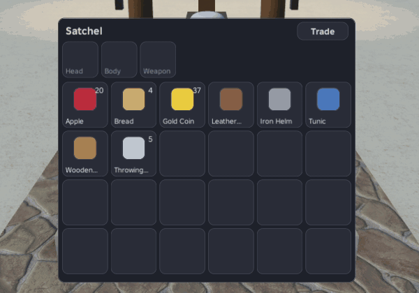
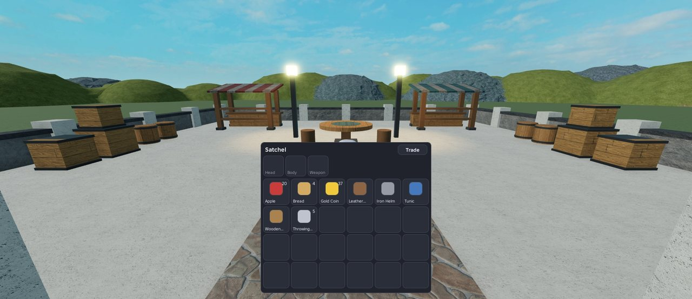
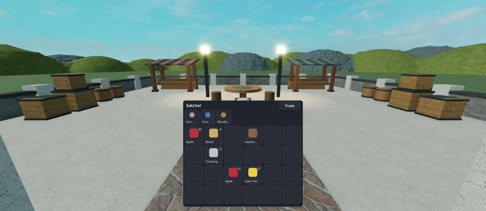

<div align="center">

# satchel

Session-locked player data, stacking inventory, equip slots and safe two-player trading for Roblox. It leaves out shops, crafting, item art and any purchase flow.

    

Refer to [LICENSE](LICENSE) for the legal bits.

</div>



## What's in it

- **Session lock with a lease.** Each load claims the player's record with a lease through one `UpdateAsync`. The lease belongs to that one session (the server's JobId plus a fresh GUID), so neither two servers nor two sessions on the same server can both write the same profile. A lease that nobody refreshed (a crashed server) expires and can be taken over. A server that finds its lease gone stops saving and kicks the player instead of overwriting the new owner's data.
- **Saves that can't go back in time.** Every save builds its payload inside the `UpdateAsync` transform, so a save that waited for budget or was re-run writes the data as it is then, not an older copy. Saves and the release for one session queue behind each other instead of racing.
- **Retries and budget waits.** Loads retry with doubling waits (1, 2, 4 and 8 seconds by default). A release keeps retrying, with waits capped at 30 seconds, for up to the lease length, and a quick rejoin on the same server waits for it. Before each DataStore call the store waits for request budget, for up to 10 seconds, so a busy server queues instead of throwing.
- **Schema migrations, and a read-only mode.** Saved data carries a schema number and is upgraded step by step on load, and the server won't start unless there is one step per schema bump. A record written by a newer version of the game loads read-only: the player can see their bag but can't change it or trade on that server, and is told why. So an old server can never write over data it doesn't understand, or trade away items it won't save. A record that can't be opened fails the load and hands the lease straight back.
- **Stacking inventory.** Adds fill part-full stacks before taking a new slot, and every change is all-or-nothing. A refused call leaves the bag exactly as it was.
- **Equip slots.** Items with a slot equip from the bag. Whatever was already worn goes back into the bag first, or the equip is refused.
- **Two-player trades.** Offers are references until commit. Any change to an offer clears both confirmations, and the items only move after both players have confirmed and the countdown has run out. The commit is worked out on copies of both bags and written back only if every step worked.
- **Server authority.** Clients send intent only. Every call is checked for type and range, rate limited per player and then checked against the game rules. A refused call is dropped and counted, and nothing is sent back about why.

```lua
-- src/shared/Config.luau
Items = table.freeze({
	apple = table.freeze({ name = "Apple", maxStack = 20, slot = nil, colour = { 200, 60, 60 } }),
	iron_helm = table.freeze({ name = "Iron Helm", maxStack = 1, slot = "Head", colour = { 150, 155, 165 } }),
}),
```

## 🎮 Demo place

`demo/satchel.rbxl` is a ready-made place: a walled trading yard with a trade table and market stalls. Open it in Studio and press Play; B shows and hides the bag. Click an item to wear it, drag to move it, and hold Shift while dragging to split a stack. Every shot here comes from a Studio play test of that place.

| Before | After |
|---|---|
|  |  |

For these shots the starting items in `Config.luau` were swapped for a fuller set. The shipped config starts a new player with 5 apples. Trading needs two players, so it isn't shown here; it's covered by the Lune tests, and you can try it in Studio with a two-player local server.

## 🏗️ Architecture

```
                     Player joins / leaves / autosave / shutdown
                                   |
                                   v
 init.server.luau  ------->  Sessions  ---->  Store  ---->  Lease (claim / refresh / release)
 (services, remotes)                            |    ---->  Migrations + Steps (schema upgrades)
        |                                       |    ---->  Profile (defaults, encode / decode)
        |                                       v
        |                                  DataStore  (MemoryStore in Studio)
        |
        |  Request (RemoteFunction)        Sync (RemoteEvent)
        |  <---------------------------    --------------------------->
        v                                                            client
   Handlers  -- Validate, RateLimiter ---> Inventory (pure functions)
        |                                  Trade (two-player factory)
        v
   Sync snapshots to the players involved
```

- **init.server.luau** is the only server file that touches Players, DataStoreService and remotes. It builds Sessions, the Store and Handlers with their dependencies and runs the autosave, trade tick and shutdown loops.
- **Sessions.luau** is the session lifecycle on one server: load on join, release on leave, autosave and the shutdown wait. It runs one load or release per player at a time and says which bags may change.
- **Data/Lease.luau** holds the pure claim, refresh and release transforms that run inside `UpdateAsync`.
- **Data/Migrations.luau** upgrades saved data one schema step at a time and flags records from the future as read-only. **Data/Steps.luau** holds the steps.
- **Data/Profile.luau** is what a new profile holds (starting items included, so the first claim writes them) and how session data is encoded for storage.
- **Data/Store.luau** loads, saves and releases sessions over a DataStore, with retries, budget waits, a per-session write queue and lease loss handling.
- **Data/MemoryStore.luau** is an in-memory stand-in with the same `UpdateAsync` contract, used in Studio.
- **Inventory/Inventory.luau** is the bag: add, remove, move, split, equip, unequip, plus the DataStore-safe encoding.
- **Trade/Trade.luau** is one trade between two players: offers, confirmations, countdown and the all-or-nothing commit.
- **Handlers.luau** validates and routes every client request, runs the trade lifecycle and decides who gets a Sync.
- **shared/Config.luau** is the one place to edit items, slots, limits and timings. **ConfigCheck.luau** refuses to start the server on a bad config. **RateLimiter.luau** and **Validate.luau** are the small shared helpers.
- **client/** builds the bag, equip slots and trade window in code. It never changes the bag itself and redraws from the next Sync.

## 🚀 Quick start

```
rokit install
rojo serve
```

Open `demo/satchel.rbxl` in Studio, connect the Rojo plugin and press Play. You should see a bag of 24 slots along the bottom with five apples in it. Drag a stack to another slot to move it, hold Shift and drag to split it in half, drag an item onto an equip slot to wear it, and press B to hide the bag. The Trade button opens a list of the other players. With two players in range, one sends a request, the other accepts, and both click items in their bags to put them on the table.

In Studio the server uses an in-memory store, so nothing is saved between sessions. To use the real DataStore, set the attribute `SatchelUseDataStore` to true on ServerStorage and turn on API access for the place.

## 🧪 Testing

```
lune run tests/run
```

140 tests, all passing:

- Rate limiter (4): a full bucket allows exactly its capacity, time refills it, it never overfills, and forgetting a key resets only that key.
- Validate (10): integers, strings, unit vectors and set membership, including NaN, infinity, floats, wrong types and out-of-range values.
- Config checks (11): the shipped config and migration steps pass, and each rule (lease length, retries, close timeout, stack sizes, slots, starting items, offer slots, schema version, one migration step per bump) fails when broken and passes when fixed.
- Lease (13): new, taken, stolen and held outcomes, expiry, refresh, release, lost leases, records with no lease, a release that already landed, and no mutation of the stored record.
- Migrations (5): steps run in order, current records are unchanged, records from the future go read-only, the input is never mutated, and a missing step names the schema.
- Fake data store (4): the fake re-runs transforms on fresh copies, re-runs when the record changes between read and write, can fail after writing, and cancels on nil.
- Store (11): fresh loads, two-server lockout, stealing an expired lease, load retries, persistent failure, the budget wait coming before the call, read-only saves and releases, double release, round trips and the encode hooks.
- Store leases (8): two sessions on one server, the lease owner, a claim or release that landed but errored, long release outages with capped waits and a wait limit, and a release after another server took over.
- Store loads (8): records that can't be migrated or decoded, or have no data, hand the lease back; no wait after the last attempt; landed claims cleared after a failure or a call-off; budget readings that throw; and loads called off when the player leaves.
- Store saves (5): an older autosave can't land after a newer save, a budget wait or a re-run writes current data, a release queued behind a save, and every transform giving the same record when re-run.
- Profile (5): starting items in the default data and written once by the first claim, every field kept through encode and decode, copies rather than shared tables, and refused non-table data.
- Sessions (7): a quick rejoin waiting for the old release, a rejoin during a slow load, loads stopping when the player leaves, shutdown waiting for loads and releases within its timeout, read-only and lost sessions, and a trade with a read-only player duplicating nothing.
- Inventory (17): stacking, refusals that leave the bag untouched, remove, move, merge, swap, split, equip, unequip and the DataStore encoding.
- Trade (12): swaps, confirmations cleared by changes, commits cancelled when a bag changed or is full, a player leaving, a side that can't save, offer limits, countdown timing and gifts.
- Handlers (18): argument checks, rate limiting, trade requests and range, request timeouts, a full trade with saves, players walking apart, quiet ticks, view-only players told why, leaving mid-countdown and a session that has gone.
- Memory store (2): copies on the way in and out, and the cancel-on-nil contract.

The entry scripts and the UI can't run under Lune. They build with Rojo and are checked in Studio. The server entry script is wiring only: the session lifecycle it starts lives in Sessions.luau, which is tested.

## ⚠️ Honest limits

- A trade writes two DataStore keys, and that isn't atomic. Each trade saves both players straight after the commit, and an older autosave can't overwrite those saves, but a server crash between the two saves can still lose or duplicate the traded items.
- If the DataStore stays down for longer than the lease (3 minutes by default) after a player leaves, the release gives up and whatever they did since the last successful save is lost. Until the release lands or the lease runs out, a rejoin on another server is turned away with "rejoin in a minute".
- During a rolling update, a player whose record was saved by the newer version can only look at their bag on an older server. They have to rejoin a newer server to change it or trade.
- A release that landed but whose call errored is recognised when it retries. If another server has claimed and released the record in between, it is logged as lost even though the data was written.
- In Studio the demo uses an in-memory store unless the `SatchelUseDataStore` attribute is set, so it proves the flow but not real DataStore behaviour such as throttling. The Lune fake does model re-runs, interleaved calls and calls that fail after writing. What the request budget reads in Studio with the real store and no API access hasn't been checked. If it reads 0, each call waits 10 seconds first.
- There's no global trade log and no rollback tool. If a trade goes wrong, there is nothing here to undo it.
- The lease protects against two servers writing at once, not against a player's data being edited from outside the game.
- Item definitions live in the `Config.luau` table. There is no item catalogue, no art and no purchase flow.
- The UI is functional rather than finished: no gamepad support, no animation and a fixed layout.

## Licence

MIT.
